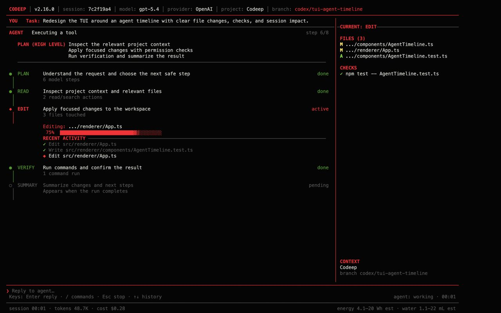

# Codeep

<p align="center">
  
</p>

<p align="center">
  <strong>Deep into Code.</strong>
</p>

<p align="center">
  
</p>

<p align="center">
  Autonomous AI coding agent that reads your project, runs commands, and writes &amp; verifies code — deeper than autocomplete. Any model (Claude, Gemini, DeepSeek, GLM, OpenAI, or your own local/custom), in the terminal and the native Mac app.
</p>

<p align="center">
  <a href="https://www.npmjs.com/package/codeep"></a>
  <a href="https://www.npmjs.com/package/codeep"></a>
  <a href="https://github.com/VladoIvankovic/Codeep/blob/main/LICENSE"></a>
</p>

## Contents

- [Install](#installation) · [Quick start](#quick-start) · [Upgrading](#upgrading)
- [One agent, every surface](#one-agent-every-surface) · [Features](#features) · [Dashboard](#codeep-dashboard)
- [Commands](#commands) · [Keyboard shortcuts](#keyboard-shortcuts) · [Configuration](#configuration)
- [Contributing](#contributing)

Full documentation: **[codeep.dev/docs](https://codeep.dev/docs)**


## One agent, every surface

Codeep keeps the same project context, provider configuration, sessions, and
agent workflow wherever you work:

- **[Terminal / TUI](https://codeep.dev/docs/installation)** — the primary CLI experience, with Plan → Read → Edit → Verify → Summary, live file changes, checks, token cost, and estimated energy and cooling-water impact.
- **[macOS app](https://codeep.dev/docs/mac)** — a native SwiftUI workbench with project conversations and Run Inspector.
- **[Web dashboard](https://codeep.dev/dashboard)** — synced sessions, usage, costs, tasks, and project activity.

## Installation

### Option 1: npm (Recommended)

```bash
npm install -g codeep
```

**Update:**
```bash
npm update -g codeep
```

### Option 2: curl

For a machine without Node. The script is served from codeep.dev and fetched from
this repository's newest release, so the command does not change if the repository
moves.

```bash
curl -fsSL https://codeep.dev/install.sh | bash
```

**Custom installation directory:**
```bash
curl -fsSL https://codeep.dev/install.sh | INSTALL_DIR=~/.local/bin bash
```

**Specific version:**
```bash
curl -fsSL https://codeep.dev/install.sh | VERSION=3.1.1 bash
```

### Option 3: Manual Binary

Download the archive for your platform from [GitHub Releases](https://github.com/VladoIvankovic/Codeep/releases). Each one holds a single executable named like the archive without `.tar.gz`:

| Platform | Archive |
|----------|---------|
| macOS Apple Silicon (M1/M2/M3/M4) | `codeep-darwin-aarch64.tar.gz` |
| macOS Intel | `codeep-darwin-x86_64.tar.gz` |
| Linux x86_64 | `codeep-linux-x86_64.tar.gz` |
| Linux ARM64 | `codeep-linux-aarch64.tar.gz` |

```bash
# Example for macOS Apple Silicon:
curl -fsSL https://github.com/VladoIvankovic/Codeep/releases/latest/download/codeep-darwin-aarch64.tar.gz | tar -xz
chmod +x codeep-darwin-aarch64
sudo mv codeep-darwin-aarch64 /usr/local/bin/codeep
```

GitHub shows a SHA-256 digest next to each archive on the release page, for checking the download.

## Quick Start

```bash
# Navigate to your project directory
cd /path/to/your/project

# Start Codeep
codeep

# On first run, enter your API key
# Get one at: https://z.ai/subscribe?ic=NXYNXZOV14
```

After installation, `codeep` is available globally in your terminal. Simply run it from any project directory to start coding with AI assistance.

## Upgrading

Running `npm install -g codeep@latest` picks up the new version — config,
saved profiles, project memory, MCP servers, and skill bundles all carry
over. Breaking changes (if any) are listed at the top of each release in
[CHANGELOG.md](CHANGELOG.md); the last breaking change was
[2.0.0](CHANGELOG.md#200--2026-05-18) (MCP `clientInfo` version bump,
transport-agnostic `McpServer` shape).

## Features

### Multi-Provider Support
- **Z.AI (ZhipuAI)** — GLM models (Coding Plan & pay-per-use API, international & China)
- **OpenAI** — GPT models (flagship, Mini, Nano)
- **Anthropic** — Claude models (Fable, Opus, Sonnet, Haiku)
- **DeepSeek** — DeepSeek models (Pro, Flash)
- **Google AI** — Gemini models (Pro, Flash)
- **MiniMax** — MiniMax models (Coding Plan & pay-per-use API, international & China)
- **Ollama** — Run any model locally or on a remote server, no API key required. Models are fetched dynamically from your Ollama instance.
- **OpenRouter** — One key, 100+ models from Anthropic, OpenAI, Google, Meta, Mistral, DeepSeek, Qwen, xAI and more. Per-call cost reported directly by OpenRouter (matches their dashboard exactly). Use `openrouter/auto` to let OpenRouter pick the best model. Tune routing with `/openrouter prefer|ignore|fallbacks|privacy`.
- **Custom (OpenAI-compatible)** — Point Codeep at any self-hosted or proxied OpenAI-compatible endpoint (vLLM, LiteLLM, LM Studio, text-generation-webui). Set the base URL in `/settings` → **Custom Base URL** (config key `customBaseUrl`, e.g. `http://host:8000/v1`), then pick your model with `/model` (fetched from the server's `/models`). No API key required unless your endpoint enforces one. The `openai` provider also honors the `OPENAI_BASE_URL` env var for proxies that serve `gpt-*` model names.
- Switch between providers with `/provider`
- Configure different API keys per provider
- Both OpenAI-compatible and Anthropic API protocols supported

### Project Context Awareness
When started in a project directory, Codeep automatically:
- Detects project type (Node.js, Python, etc.)
- Reads file paths mentioned in your messages
- Attaches file contents to conversations
- Understands your project structure
- Can suggest and apply code changes (with write permission)

### Session Management
- **Auto-save** - Conversations are automatically saved
- **Session picker** - Choose which session to continue on startup
- **Per-project sessions** - Sessions stored in `.codeep/sessions/`
- **Rename sessions** - Give meaningful names with `/rename`
- **AI session titles** - Sessions auto-title themselves with an LLM one-liner ("OAuth2 migration for auth module") instead of a truncated first message. This makes one small background API call per session; turn it off with the `autoSessionTitle` setting (`/settings`) if you prefer zero unsolicited calls
- **Cross-session recall** - `/recall <query>` searches across **all** saved sessions, ranked by relevance + recency. Add `--resume` to load the top match, or `--summarize` for an LLM recap of what you accomplished across matches
- **Cross-device resume (`/cloud`)** - Sessions you run on one device (CLI, Mac app) sync to `codeep.dev`. `/cloud` lists them and pulls the selected one back locally, so you can start a session on your desktop and continue on your laptop. Run `codeep account` once to link your devices; scoped to the current project when one is open.
- **Export** - Save to Markdown, JSON, or plain text
- `/usage` - This session's token usage and estimated cost (per provider/model; a model priced by prompt length, like Claude Haiku 5.5 above 100K tokens, is priced request by request), then what Codeep used across sessions. `/usage --detail` adds the per-model breakdown, prompt-cache figures and the pricing table
- `/compact [keepN]` - AI-summarize older messages to free up context (keeps last N, default 4)
- `/checkpoint [name]` - Snapshot the current session (conversation + provider/model + agent-touched files + git HEAD)
- `/checkpoints` - List saved checkpoints for this workspace
- `/rewind <id>` - Restore a checkpoint; file rollback is handled via git (hint printed after rewind)

### Git Integration
- `/diff` - Review unstaged changes with AI assistance
- `/diff --staged` - Review staged changes
- `/commit` - Generate conventional commit messages

### Code Block Management
- Automatic syntax highlighting for 12+ languages
- Code blocks are labelled with their language and a number

### Clipboard Paste
- Paste with Ctrl+V or your terminal's paste shortcut
- A block of lines shows a preview with its character/line count before it is added
- Press Enter to send, Escape to cancel

### File Context (`@mentions`)
Attach files to a message by naming them in it:

- **`@path/to/file`** - Inline mention: type `@` followed by a file path anywhere in your message and its contents are attached for that message only. Supports relative paths (`@src/index.ts`), absolute (`@/etc/hosts`), home (`@~/.codeep/profile.md`), and quoted paths with spaces (`@"my file.ts"`). In the CLI, typing `@` opens an autocomplete file picker — ↑↓ to navigate, Tab to insert.
- **`@folder <path>`** (alias `@dir`) - Attach an entire directory: type `@folder src/components` and every source file under it is loaded recursively. Skips `node_modules`, `.git`, `dist`, binary extensions (images, archives, lockfiles), and files over the per-file size cap. Stops at a 200 KB total cap per mention (with a notification when it hits the limit). Quoted paths supported: `@folder "my components"`.
- **`@web <url>`** - Inline web fetch: type `@web https://example.com/docs` (or `@web example.com/docs`) and the page is fetched, converted to readable text, and attached to the message. HTML is stripped; plain text and JSON pass through as-is. Capped at 32 KB, 12 s timeout. Successful fetches are cached for 30 min (per session, up to 50 entries) so repeated `@web` for the same URL is instant and free.
- **`@git <ref>`** - Inline git context: type `@git diff`, `@git diff --staged`, `@git HEAD`, `@git <sha>`, `@git main:src/x.ts`, or `@git diff a..b` to inject that diff / commit / file-at-ref into the message as a `[Git ref]` block. Capped at 64 KB per mention (truncated with a marker). Unknown refs surface a friendly failure note.

`@mentions` are per-message — handy for one-off references without polluting the conversation.

```
> review @src/auth/login.ts for security issues
Loaded 1 file(s) from @mentions
# AI sees login.ts attached for this message only

> compare @src/utils/api.ts with @src/types/index.ts
# AI sees both files attached to this message
```

### Multi-line Input
Write multi-line messages using backslash continuation or `/multiline` mode:

- **Backslash continuation** — end a line with `\` and press Enter to continue on the next line
- **`/multiline`** — toggle multi-line mode where Enter adds a new line and Esc sends the message

```
> Write a function that\
  takes two arguments and\
  returns their sum
# Sent as a single 3-line message

> /multiline
Multi-line mode ON — Enter adds line, Esc sends
M> (type freely, Enter = newline, Esc = send)
```

### Autonomous Agent Mode

Codeep works as a **full AI coding agent** that autonomously:
- Creates, edits, and deletes files
- Executes shell commands (npm, git, build, test, etc.)
- Reads and analyzes your codebase
- Loops until the task is complete
- Reports all actions taken
- **Live code display** - Shows syntax-highlighted code in chat as it writes/edits files

**Auto mode (default)**: Just describe what you want - no special commands needed:
```
> add error handling to src/api/index.ts
> run tests and fix any failures
> create a new React component for user settings
```

**Manual mode**: Use `/agent <task>` when you want explicit control.

> **Note for Ollama users:** Agent mode requires a capable model — at least **7B parameters** (e.g. `qwen2.5-coder:7b`, `llama3.1:8b`). Smaller models (1–3B) lack the instruction-following capacity for reliable tool use and may produce incorrect output. For small models, set Agent Mode to **Manual** or **Off** in `/settings`.

**Agent Tools:**
| Tool | Description |
|------|-------------|
| `read_file` | Read file contents |
| `write_file` | Create or overwrite files |
| `edit_file` | Edit specific text in files |
| `delete_file` | Delete files or directories |
| `create_directory` | Create folders |
| `list_files` | List directory contents |
| `execute_command` | Run shell commands |
| `search_code` | Search for patterns in code |
| `fetch_url` | Fetch content from URLs |

### Undo & History
- **Undo actions** - Revert any file change the agent made
- **Session history** - View and restore from previous agent sessions
- **Action tracking** - All file operations are logged for review

### Context Persistence
- **Save conversations** - Continue where you left off
- **Per-project context** - Each project maintains its own history
- **Automatic summarization** - When prior history overflows the agent's context budget, the dropped (oldest) messages are condensed into a short recap (decisions, constraints, unfinished threads) instead of being silently truncated — so long sessions don't forget how they started. One cheap LLM call, made only on overflow and cached per session; opt out with `autoSummarizeHistory: false` (`/settings`)

### Web & MCP Tools
- Agent can fetch documentation and web content
- Automatic HTML-to-text conversion
- **MCP-powered tools** (for Z.AI and Z.AI China providers):
  - `web_search` — Search the web for current information
  - `web_reader` — Fetch and read any web page
  - `zai_analyze_image` — Analyze images via Z.AI Vision (GLM-4V)
  - `minimax_understand_image` — Analyze images via MiniMax vision
- **Image paste** — Ctrl+V an image directly into the terminal to send it to a vision model
- MCP tools run as secure sub-processes with structured I/O

### Smart Context
Agent automatically gathers relevant files before making changes:
- Analyzes imports and dependencies
- Reads related type definitions
- Understands project structure
- Prevents duplicate code and inconsistencies

### Code Review Mode
AI-powered review of your git diff with `/review`:
- **Bugs** — logic errors, off-by-one, null/undefined issues
- **Security** — injection, auth issues, exposed secrets
- **Performance** — unnecessary loops, memory leaks
- **Edge cases** — unhandled inputs, missing error handling
- References file names and line numbers from the diff

```
> /review            # AI review of unstaged changes
> /review --staged   # AI review of staged changes
> /review --static   # Static regex analysis with score (0-100)
```

If there are no git changes, falls back to static analysis automatically.

#### Custom rules (`.codeep/review.yml` or `.codeep/review.json`)

The static reviewer (`codeep review` / `/review --static`) ships a set of
built-in rules, but a project can tailor them — check a `.codeep/review.yml`
(or `.codeep/review.json`) into the repo and the CLI **and** the
[Codeep GitHub Action](https://github.com/VladoIvankovic/codeep-action) both
pick it up automatically (zero LLM cost). YAML is preferred when present and is
nicer for regexes — single-quoted YAML keeps backslashes literal
(`pattern: '\bfoo\('`) so you avoid JSON's double-escaping:

```yaml
# .codeep/review.yml
rules:
  - id: no-internal-import
    pattern: "from ['\"]@acme/internal"
    category: best-practice
    severity: error
    message: Don't import from @acme/internal outside the platform team
    suggestion: Use the public @acme/sdk package
    extensions: [.ts, .tsx]
disable: [todo-comment, anonymous-function]
include: ['src/**']
exclude: ['**/*.test.ts', 'vendor/**']
```

The same config as JSON:

```json
{
  "rules": [
    {
      "id": "no-internal-import",
      "pattern": "from ['\"]@acme/internal",
      "category": "best-practice",
      "severity": "error",
      "message": "Don't import from @acme/internal outside the platform team",
      "suggestion": "Use the public @acme/sdk package",
      "extensions": [".ts", ".tsx"]
    }
  ],
  "disable": ["todo-comment", "anonymous-function"],
  "include": ["src/**"],
  "exclude": ["**/*.test.ts", "vendor/**"]
}
```

- **`rules`** — your own checks. `id`, `pattern` (a regex string), and `message`
  are required; `flags` (default `g`), `category`, `severity`
  (`error|warning|info|suggestion`), `suggestion`, and `extensions` are optional.
- **`disable`** — turn off built-in rules by id. Run `codeep review --rules` for
  the live list; the built-in ids are: `eval-usage`, `inner-html`,
  `dangerously-set-inner-html`, `hardcoded-password`, `hardcoded-api-key`,
  `foreach-await`, `await-in-loop`, `select-star`, `loose-null-check`,
  `empty-catch`, `console-statement`, `todo-comment`, `any-type`, `ts-ignore`,
  `as-any`, `var-usage`, `anonymous-function`, `missing-jsdoc`, `long-file`,
  `long-function`.
- **`include` / `exclude`** — glob scoping (`**`, `*`, `?`); `include` empty = all files.

A missing, malformed, or partially-invalid config never breaks a review — bad
entries are skipped and the run proceeds with whatever is valid.

**More review commands:**
- `codeep review --rules` — list the built-in rule ids (above) and exit.
- `codeep review --ai` — after the offline pass, get an advisory AI second
  opinion on the working-tree diff from your configured provider (needs an API
  key; never changes the exit code, so CI stays deterministic).
- `codeep hook install` — install a git pre-commit hook that reviews the
  working-tree content of your staged files and blocks the commit on failures
  (`--pre-push` for pre-push, `--fail-on <level>` to set the threshold,
  `codeep hook uninstall` to remove). Stage changes fully before committing.

### Interactive Mode
Agent asks clarifying questions when tasks are ambiguous:
```
You: "add authentication"
Agent: "What type of authentication do you want?
        a) JWT tokens
        b) Session-based
        c) OAuth (Google/GitHub)"
```

### Diff Preview
See exactly what will change before applying:
```diff
- const user = getUser();
+ const user = await getUser();
```

### Learning Mode
Agent learns your coding preferences:
- Indentation style (tabs/spaces)
- Quote style (single/double)
- Naming conventions
- Preferred libraries
- Custom rules you define

### User Profile (`/me`)
A durable, human-readable description of **you** that Codeep injects into the agent's context on every run — so it adapts to how you work (reply language, response style, default stack, "always / never" rules). It flows to every surface since they share the same files.

Two layers:
- **`~/.codeep/profile.md`** — global: who you are across all projects
- **`.codeep/profile.md`** — project: your role, goals, and constraints for this repo

Commands:
- `/me` — view your profile + status
- `/me init [project]` — scaffold a template to fill in
- `/me on` / `/me off` — toggle injection
- `/me learn [on|off]` — opt-in auto-learn: Codeep extracts durable preferences from sessions and merges them into `profile.learned.md` (kept separate from your hand-written file). Off by default.
- `/me learn project` — one-off learn scoped to this repo
- `/me forget` — clear the auto-learned profile(s)

Sync your global profile across machines (and edit it on the web) from the [dashboard](https://codeep.dev/dashboard): `/me sync` (or `codeep account sync`, which now carries the profile too).

### Sub-agents (delegation)
The agent can delegate a self-contained sub-task to a specialist **sub-agent** that runs in its own fresh context window and returns only a summary — keeping the main context small and letting each sub-task run with a tuned persona and scoped tools.

Built-ins:
- **`planner`** — read-only; investigates, then returns a step-by-step implementation plan
- **`researcher`** — read-only; explores the codebase/web and returns a tight, cited summary
- **`reviewer`** — read-only; senior review for correctness, security, and design
- **`tester`** — writes and runs tests, iterates to green

Run `/agents` to list them. The agent invokes them itself via the `delegate` tool (you'll see `⤷ <agent>: …` lines). Add your own with a frontmatter `.md` in `.codeep/agents/<name>.md` (project) or `~/.codeep/agents/<name>.md` (global):

```markdown
---
name: migrator
description: Writes and runs database migrations
tools: [read_file, write_file, edit_file, execute_command]   # allowlist; omit = all
model: glm-5.2            # optional override
personality: senior-reviewer   # optional preset
maxIterations: 12         # optional budget
---
You write safe, reversible DB migrations…
```

`tools` is an allowlist enforced at dispatch (a `researcher` literally can't write files). Sub-agents inherit your profile + project rules, and their changes are covered by `/undo`.

**Guaranteed review:** enable **Agent Auto-Review** in `/settings` (`agentAutoReview`) and after any run that changes files, Codeep automatically delegates to the `reviewer` and appends its findings — a review stage that always happens; a reviewer that writes nothing is shown as "(the reviewer finished without writing a review)". Off by default.

### Project Rules
Define project-specific instructions that the AI always follows. Create a rules file in your project root (first non-empty file wins):

- **`.codeep/rules.md`** - Primary location (inside `.codeep/` folder)
- **`CODEEP.md`** - Alternative location (project root, similar to `CLAUDE.md` or `.cursorrules`)
- **`AGENTS.md`** - Cross-tool standard (works with Claude Code, Cursor, Kilo Code — no duplication needed)

The rules file content is automatically included in every system prompt — both chat and agent mode. Use it to define:

- Coding standards and conventions
- Preferred libraries and frameworks
- Architecture guidelines
- Language-specific instructions
- Any custom rules for AI behavior in your project

**Example `.codeep/rules.md`:**
```markdown
## Code Style
- Use 2 spaces for indentation
- Prefer arrow functions
- Always use TypeScript strict mode

## Architecture
- Follow MVC pattern
- Keep controllers thin, logic in services
- All API responses use the ApiResponse wrapper

## Libraries
- Use Zod for validation
- Use date-fns instead of moment.js
```

Rules are loaded automatically when Codeep starts — no commands needed.

### Skills System
Codeep ships one built-in skill, `/commit` (shortcut `/c`): it shows the diff, asks the model for a conventional commit message, asks you to confirm, then commits.

```
/commit                       # generate the message, confirm, commit
/commit fix: handle empty list # use your own message (skips the model), still asks first
```

Everything else the 3.x built-ins did — write tests, refactor, fix, explain, make a Dockerfile, push, branch, stash — is a plain request to the agent ("write tests for src/utils/api.ts"), or a skill, command or bundle of your own:

- **Skills** — JSON files in `~/.codeep/skills/` (below)
- **Slash commands** — Markdown templates in `.codeep/commands/` ([Custom Slash Commands](#custom-slash-commands))
- **Skill bundles** — `SKILL.md` packages the agent can invoke (`/skills bundles`, `/skills browse`)

**Skill Chaining:** Run skills in sequence with `+`, for example `/commit+my-skill` (a skill of yours).

**Search Skills:**
```
/skills lint          # Find skills related to lint
```

**Custom Skills:** Create your own skills:
```
/skill create my-workflow        # Creates template in ~/.codeep/skills/
/skill delete my-workflow        # Delete custom skill
/skill help commit               # Show skill details
```

Custom skill example (`~/.codeep/skills/my-workflow.json`):
```json
{
  "name": "my-workflow",
  "description": "My custom workflow",
  "shortcut": "m",
  "parameters": [
    { "name": "target", "description": "Target environment", "required": true }
  ],
  "steps": [
    { "type": "command", "content": "npm run build" },
    { "type": "confirm", "content": "Deploy to ${target}?" },
    { "type": "agent", "content": "Deploy the application to ${target}" },
    { "type": "notify", "content": "Deployed to ${target}!" }
  ]
}
```

### MCP (Model Context Protocol)
Full spec coverage in 2.0.0 — stdio and Streamable HTTP transports,
tools / resources / prompts / sampling, capability negotiation with
`roots`, auto-restart on crash, mid-run catalog refresh.

**Three ways to wire MCP servers** (all merge; on a name clash global wins, then project, then `.mcp.json` — a repository's entry never replaces a server you configured globally; it is left out with a one-line notice):

1. **Project config** — `.codeep/mcp_servers.json` (committed with the repo)
2. **`.mcp.json`** — cross-tool standard at the workspace root (works with Claude Code, Cursor, Kilo Code — point everyone at the same file)
3. **Global config** — `~/.codeep/mcp_servers.json` (per machine)

Two transports per entry, mutually exclusive:

```json
{
  "mcpServers": {
    "fs":     { "command": "npx", "args": ["@modelcontextprotocol/server-filesystem", "/path"] },
    "remote": { "url": "https://mcp.example.com/", "headers": { "Authorization": "Bearer …" } }
  }
}
```

Manage interactively from any Codeep client:

```bash
/mcp                            # list connected servers + tools + spawn errors
/mcp browse                     # 9 curated servers (filesystem, git, fetch, brave-search, playwright, …)
/mcp browse <id>                # details + env-var hints for one entry
/mcp install <id> [extra args]  # wires it into project config + spawns
/mcp add <name> <command> [args]
/mcp remove <name>
/mcp reload                     # re-read config after a manual edit
/mcp resources                  # list resources servers expose
/mcp read <uri>                 # fetch one resource's contents
/mcp prompts                    # list prompt templates
/mcp prompt <server> <name> key=val
```

Resources and prompts also surface as **virtual tools** the agent can
call natively — `<server>__resource_list`, `<server>__resource_read`,
`<server>__prompt_list`, `<server>__prompt_get`. No need to type
`/mcp read` yourself; the model decides when to fetch.

If a server opts into the `sampling` capability, Codeep hosts LLM
completions on its behalf — routes through your active provider. If it
opts into `roots/list`, we expose the current workspace folder.

Each server is spawned as a child process; its tools are surfaced under
`<server>__<tool>`. MCP tool definitions are automatically injected into
the agent's tool catalog on each iteration, so the model picks them
alongside built-ins without you having to mention them by name.

A server you configure once in the global config is available in every
project.

A server that crashes is auto-restarted (up to 3 times in a 60 s window,
with exponential backoff). Persistent failures are reported in `/mcp` so
you don't have to hunt through stderr. The `roots` capability is
advertised in the MCP handshake, so filesystem-shaped servers can
scope their reads to the current workspace.

Hooks apply to MCP tools too: `pre_tool_call` can block a `<server>__<tool>`
call, and `on_error` fires when it fails. See **Lifecycle Hooks** below.

### Lifecycle Hooks
Drop executable shell scripts in `.codeep/hooks/<event>.sh` and Codeep runs them at
the relevant moment during a session. Generalises what `agentAutoCommit` and
`agentAutoVerify` do — anything those can do, a `post_edit` hook can do too.

| Event | When | Blocking? |
|---|---|---|
| `pre_tool_call` | Before every agent tool call (including MCP `<server>__<tool>`) | **Yes** — non-zero exit blocks the call |
| `post_edit` | After `write_file` / `edit_file` succeeds (built-in only) | No (advisory: auto-format / auto-lint) |
| `on_error` | When any tool call fails (built-in or MCP) | No (logging / alerting) |
| `pre_commit` | Before the `/commit` skill stages anything | **Yes** — non-zero exit blocks the commit |

`pre_tool_call` and `on_error` apply uniformly to built-in tools (`read_file`,
`execute_command`, …) and MCP tools (`fs__read_file`, `gh__create_issue`, …).
A policy script can therefore allow-list or deny MCP calls just like any
other agent action.

Each hook receives `CODEEP_HOOK_EVENT`, `CODEEP_WORKSPACE`, `CODEEP_SESSION_ID`,
plus event-specific extras (`CODEEP_HOOK_TOOL`, `CODEEP_HOOK_PARAMS`, `CODEEP_HOOK_FILE`).

Example — auto-format on edit (`.codeep/hooks/post_edit.sh`):

```bash
#!/bin/bash
prettier --write "$CODEEP_HOOK_FILE" 2>/dev/null
```

Run `/hooks` to see which hooks are installed in the current workspace.

**Trust required (security).** Because hooks run arbitrary shell, a freshly
cloned repo's hooks are **not** run until you approve the workspace. Run
`/hooks trust` to enable them for the current project (revoke with
`/hooks untrust`); `/hooks` and the welcome banner show the trust state. Your
own projects just need a one-time `/hooks trust`. Global `~/.codeep/hooks/` are
never run for the same reason.

#### Windows notes

Lifecycle hooks are POSIX shell (`.sh`) scripts:

- **macOS / Linux** — run directly (via the script's shebang). No setup.
- **Windows** — a `.sh` needs a POSIX `sh`. Install [Git for Windows](https://git-scm.com/download/win)
  (it ships `sh.exe`) and Codeep runs `.sh` hooks through it automatically — no
  PATH tweaking needed if Git is installed to its default location. **Without a
  POSIX shell**, `/hooks` and the welcome banner report an explicit
  *"cannot run on this system"* state and hooks are skipped — they never block a
  tool call or commit, and the rest of Codeep is unaffected. (`.ps1`/`.cmd` hooks
  are not executed; keep hook logic in `.sh`.)

Everything else is **Node-native and shell-independent on Windows**: project
rules (`AGENTS.md` / `CODEEP.md` / `.codeep/rules.md`), custom slash commands
(`.codeep/commands/*.md`), and skill bundles (`.codeep/skills/`) are Markdown;
MCP config (`.mcp.json` / `.codeep/mcp_servers.json`) is JSON. MCP servers spawn
via their configured `command` — `npx` resolves through `npx.cmd`, and a custom
`command` like `python` just needs to be on your PATH.

### Skill Bundles (new in 2.0)
Beyond the built-in skills and custom slash commands, Codeep now supports
**structured skill bundles** — directory-based capability packs the agent
discovers and invokes on its own.

A bundle is a directory with a `SKILL.md` in one of three places. When two
have the same name, the first one here wins:

1. `.codeep/skills/<name>/SKILL.md` — project-scoped
2. `~/.codeep/skills/<name>/SKILL.md` — global, Codeep's own
3. `~/.agents/skills/<name>/SKILL.md` — global, shared with other agent
   tools (Omarchy links its skills in here)

The file is Markdown with a YAML frontmatter header — the format is a
**superset of Claude Code skills**, so existing skills drop in unchanged:

```markdown
---
name: deploy-staging
description: Deploy the current branch to staging via npm scripts.
triggers: [deploy, ship, release]
# Optional Codeep-specific extensions:
codeep-min-version: 2.0.0
codeep-requires-mcp: [postgres]
allowed-tools: [read_file, write_file, execute_command]
version: 0.1.0
---

# deploy-staging

Run the test suite, build, then `npm run deploy:staging`. If the build
fails, surface the error and stop — don't deploy a broken build.
```

A long `description` can also be a folded (`>`) or literal (`|`) block.
Files a skill refers to, such as a `reporting.md` guide, sit next to its
`SKILL.md`: `invoke_skill` tells the agent the skill's directory and reads
them from there.

The agent gets the bundle catalog injected into its system prompt on
every iteration and can invoke any bundle via the `invoke_skill` tool:

- `/skills bundles` — list installed bundles
- `/skills create-bundle <name>` — scaffold a new project skill
- `/skills show <name>` — print the SKILL.md
- `/skills browse [query]` — search the public marketplace
- `/skills install <owner>/<slug>` — pull from marketplace
- `/skills publish <name> [--public]` — share to codeep.dev
- `/skills unpublish <owner>/<slug>` — remove your published skill

**Web marketplace:** publish skills to [codeep.dev/skills](https://codeep.dev/skills)
as public (browseable by anyone) or private (only you). Manage your published
skills at `/dashboard/skills`.

### Custom Slash Commands
Drop a Markdown file in `.codeep/commands/<name>.md` (project-scoped) or
`~/.codeep/commands/<name>.md` (global, all projects) and Codeep exposes it
as `/<name>`. The body becomes
the user prompt; the agent handles it normally.

Example — `.codeep/commands/sec-review.md`:

```markdown
---
description: Security review of a file
aliases: [sec, secrev]
---

Please perform a thorough security review of {{args}}. Look for:
- AuthN/AuthZ bypasses, SQL/NoSQL injection, XSS, CSRF
- Path traversal, insecure deserialization
- Hardcoded secrets, race conditions

Report findings ordered by severity.
```

Then call it as `/sec-review src/api/login.ts` (or `/sec` via the alias).

**Placeholders** (Claude Code-compatible):
- `{{args}}` and `$ARGUMENTS` — full args string
- `{{arg1}}`, `{{arg2}}` … — positional args

**Discovery:** the files in `.codeep/commands/` (project) and
`~/.codeep/commands/` (global) are the list. Project files shadow global files
with the same name. Aliases also work for autocomplete.

### Personalities and custom bots (`/personality`)

Built-in personalities change tone and priorities. A structured custom bot can
also pin a model, restrict runtime tools, and limit where it is available:

```
/personality                  # list available
/personality concise          # short answers, no preamble
/personality security         # treat every input as hostile
/personality senior-reviewer  # push back on shortcuts, name things well
/personality ship-it          # pick first reasonable approach
/personality off              # back to default tone
```

Six built-in presets: `concise`, `verbose`, `security`, `senior-reviewer`,
`junior-mentor`, `ship-it`. The active one persists across sessions
(stored in `~/.codeep/config.json` as `activePersonality`).

**Custom bots** — build one in **Dashboard → Agent Studio**, or drop a Markdown
file in
`.codeep/personalities/<name>.md` (project) or
`~/.codeep/personalities/<name>.md` (global):

```markdown
---
codeep: custom-bot/v1
description: Reviews changes without modifying the project.
model: automatic
tools: [files, git]
scope: selected
projects: [Codeep]
---
# PR Reviewer

## Responsibility
Review the requested change and cite concrete evidence.

## Always
- Call out untested behavior.

## Never
- Modify files or publish changes.

## Advanced instructions
Keep the tone collaborative and end with the highest-risk finding.
```

Portable tool groups are `files`, `terminal`, `tests`, `git`, `web`, and
`mcp`; unselected groups are removed from the model's runtime and checked
again before execution. Missing, empty, or malformed `tools` metadata in a v1
file creates a conversation-only bot. Use
`scope: all`, `selected`, or `personal`; selected scope matches the project
directory basename against `projects` (with optional `*` and `?` wildcards).
An exact `provider/model` applies only to
that run, while `automatic` inherits the current selection.

Portable v1 fails closed for unclassified capabilities: Skills, delegation,
and vision are not exposed to structured bots yet. MCP is available only when
the session has registered those exact tools.

Legacy prompt-only Markdown remains supported and unrestricted. The older
section-only Agent Studio format is recognized when it contains
`Responsibility` plus another standard section; without a Tools section it
also stays unrestricted until explicitly converted. Invalid structured model
or scope metadata makes the bot unavailable rather than silently widening its
runtime. An explicit unsupported `codeep` schema marker is also unavailable;
it is never reinterpreted as legacy. Project files shadow global files, which
shadow built-ins with the same name.

### Project Intelligence (`/init`, `/scan`)

Initialize a project and scan it once to cache deep analysis for faster AI responses:

```
/init          # Initialize project — creates .codeep/ folder
/scan          # Full project scan - analyzes structure, dependencies, patterns
/scan status   # Show last scan info (age, file count, project type)
/scan clear    # Clear cached intelligence
/memory <note>        # Add a custom note to project intelligence
/memory list          # Show all notes with indices
/memory remove <n>    # Remove note by index
/memory clear         # Clear all notes
```

**What gets analyzed and cached:**

| Category | Information |
|----------|-------------|
| **Structure** | File count, directory tree, language distribution (respects `.gitignore`) |
| **Dependencies** | Runtime & dev dependencies, detected frameworks |
| **Architecture** | Patterns (MVC, Component-based), main modules, entry points |
| **Scripts** | Available npm/composer/make scripts |
| **Conventions** | Indentation style, quotes, semicolons, naming conventions |
| **Testing** | Test framework, test directory location |
| **DevOps** | CI/CD system (GitHub Actions, GitLab CI, CircleCI, Azure, Travis, Jenkins, Drone), containerization (Docker, docker-compose, Kubernetes, Helm), monorepo tooling (Turborepo, Nx, Lerna, pnpm/Yarn workspaces, Rush) |

**Benefits:**
- AI understands your project deeply without re-analyzing each time
- Faster responses - no need to scan files repeatedly  
- Consistent context across sessions
- Framework-aware suggestions (React, Vue, Express, Django, etc.)

You can also add your own notes to the project intelligence with `/memory`:

```
/memory Always use pnpm, never npm
/memory Main entry point is src/renderer/main.ts
/memory Database migrations are in db/migrations/
```

Notes are included in every AI and agent conversation for this project.

**Storage:** `.codeep/intelligence.json` (project-local)

**Example output:**
```
# Project: my-app
Type: TypeScript/Node.js

## Structure
- 156 files, 24 directories
- Languages: TypeScript React (89), TypeScript (45), JSON (12)
- Main directories: src, components, utils, hooks

## Frameworks
React, Next.js

## Architecture
Patterns: Component-based, File-based routing
Main modules: src, components, hooks, utils

## Available Scripts
- dev: next dev
- build: next build
- test: vitest

## Code Conventions
- Indentation: spaces
- Quotes: single
- Semicolons: no
- Naming: camelCase

## DevOps
- CI/CD: GitHub Actions
- Containerization: Docker, docker-compose
- Monorepo: Turborepo
```

### Self-Verification (Optional)
When enabled in Settings, the agent can automatically verify its changes by running build, tests, or type checking after completing a task. Disabled by default — the agent works freely and you decide when to verify.

Configure in **Settings → Agent Auto-Verify**:
- **Off** (default) — no automatic verification
- **Build only** — checks compilation after changes
- **Typecheck only** — runs TypeScript/PHP type checking
- **Test only** — runs test suite after changes
- **Build + Typecheck + Test** — full verification

If errors are found, the agent tries to fix them automatically (up to 3 attempts, configurable).

**Supported project types:**

| Language | Build | Test | Type Check |
|----------|-------|------|------------|
| **Node.js/TypeScript** | npm/yarn/pnpm/bun run build | npm test, vitest, jest | tsc --noEmit |
| **Python** | - | pytest | - |
| **Go** | go build | go test | - |
| **Rust** | cargo build | cargo test | - |
| **PHP/Laravel** | composer run build | phpunit, artisan test | php -l (syntax) |

### Security Features
- API keys stored securely (macOS Keychain / Linux Secret Service)
- Per-project permissions (read-only or read-write)
- Input validation and sanitization
- Configurable rate limiting
- Agent sandboxed to project directory
- Dangerous commands blocked (rm -rf /, sudo, etc.)
- Configurable confirmation per tool — choose which agent actions require approval via `/settings`

## Codeep Dashboard

Link your CLI to [codeep.dev](https://codeep.dev/dashboard) for a personal web dashboard with session stats, project tracking, task management, and API key sync.

```bash
codeep account   # Opens browser → sign in with GitHub → CLI is linked
```

### Dashboard features

- **Usage stats** — total sessions, active this week, model/provider breakdown, token usage, estimated cost per model, 30-day trend
- **Projects** — all projects Codeep was used in, with language tag and git indicator
- **Project archiving** — hide projects from the list with one click
- **Tasks** — create/complete bug, feature, and task items from the web or directly from the CLI with `/tasks add` and `/tasks done`
- **API key sync** — store provider keys securely on codeep.dev, sync to any machine in one command
- **Personal config sync** — personalities and custom slash commands sync across machines; view and prune them on the dashboard
- **Connected devices** — see all machines linked to your account (hostname, last seen), revoke access per device

### API key sync

API keys are opt-in: they stay in your OS keychain until you turn on cloud key
sync, with `/keysync on` or from the shell. Synced keys are stored
server-readable on codeep.dev — encrypted at rest using AES-256-GCM, with a key
the server holds. Add keys once on the dashboard, then sync them to any machine:

```bash
codeep account sync --keys  # Turn on key sync and pull your keys — a new machine's first step
codeep account sync         # Pull keys (when key sync is on) + config from codeep.dev → local
codeep account push         # Push this machine's stored keys (when key sync is on) + config → codeep.dev
```

`--keys` shows the same note as `/keysync on` before turning it on, and key sync
stays on afterwards. On a terminal, on a machine with no API key yet, `codeep
account sync` without `--keys` asks first (No by default); a machine that
already has a key, a script, a pipe and CI are never asked, only told the
command to run. Keys pressed before a question appears never answer it, and
Ctrl+C at a question cancels the sync with nothing pulled. After a pull on a
terminal, or with `--keys`, if the provider Codeep would start on has no key
(one in the environment counts), it switches to the first of the pulled keys'
providers in the order `/provider` lists them, so the next `codeep` opens the
chat rather than the provider picker. Without a system keychain the keys are
stored in plain text in the config file, and the sync says so. `codeep account`
offers this sync as soon as it has linked the machine.

With key sync on, `codeep account push` uploads the API keys stored on this
machine — in the system keychain, or the plain-text fallback — and never a key
read from an environment variable; it names the providers it left out for that
reason. `/keysync off` turns key sync off again, `codeep account purge-keys`
deletes the keys stored on codeep.dev, and `CODEEP_NO_KEY_SYNC=1` keeps it off
whatever the setting says.

### Personal config sync

`account sync` / `account push` also carry your **personalities** and **custom
slash commands** between machines — the Markdown files in
`~/.codeep/personalities/` and `~/.codeep/commands/`:

```bash
codeep account push   # Upload local personalities + commands to codeep.dev
codeep account sync   # Download them onto a new machine
```

A manual `sync` treats the dashboard personality as current. When a changed
cloud personality replaces a local file, Codeep first saves the local version
under `~/.codeep/backups/personalities/` and then swaps the new file in
atomically. Custom commands keep the older **additive** merge and are never
overwritten by a pull. View and edit custom bots in **Agent Studio**, and prune
commands under **Custom commands**, on the
[dashboard](https://codeep.dev/dashboard).

Hooks and MCP server configs are deliberately **not** synced: hooks run
arbitrary shell, and MCP configs often embed tokens, so both stay local to each
machine.

### Privacy & telemetry

Once your CLI is linked, Codeep automatically uploads usage stats (model,
provider, token counts, estimated cost), session transcripts, `progress.md`,
and project memory notes to power your dashboard. To opt out of **all** of these
automatic uploads:

```bash
export CODEEP_NO_TELEMETRY=1   # also honors the cross-tool DO_NOT_TRACK=1
```

…or set it permanently in `~/.codeep/config.json`:

```json
{ "telemetry": false }
```

With telemetry off, nothing is uploaded automatically — the agent still runs
fully and talks to your LLM provider directly. Explicit `codeep account push` /
`account sync` commands are always under your control and are never gated by
this flag.

### Tasks

Create, view, and complete tasks directly from the CLI — or manage them on the codeep.dev dashboard:

```
> /tasks                    # List pending tasks for current project (numbered)
> /tasks add Fix login bug  # Create a new task on the dashboard
> /tasks done 2             # Mark task #2 as done
> /tasks delete 2           # Delete task #2 permanently
```

Tasks are loaded into the agent context so the AI sees them automatically on the next message.

## Commands

### General

| Command | Description |
|---------|-------------|
| `/help` | Show help and available commands |
| `/status` | Show current configuration status |
| `/version` | Show version and current provider/model |
| `/update` | Check for updates |
| `/usage [--days N] [--detail]` | This session's tokens and estimated cost, then what Codeep used across sessions, from its local usage ledger: today, the last 7 days, all time and tokens by model; `--days N` lists the last N days, `--detail` adds this session's per-model breakdown, prompt-cache figures and the pricing table. The ledger part is the same as `codeep usage` in the shell — see [`codeep usage`](#codeep-usage) |
| `/clear` | Clear chat history and start new session |
| `/exit` or `/quit` | Quit application |

### AI Configuration

| Command | Description |
|---------|-------------|
| `/provider` | Switch AI provider |
| `/model` | Switch AI model |
| `/model <name>` | Load a saved provider+model profile (e.g. `/model fast`) |
| `/protocol` | Switch API protocol (OpenAI/Anthropic) |
| `/lang` | Set response language (12 languages supported) |
| `/settings` | Adjust temperature, max tokens, timeout, rate limits |

### Session Management

| Command | Description |
|---------|-------------|
| `/sessions` | List and load saved sessions |
| `/sessions delete <name>` | Delete a specific session |
| `/cloud` | List and resume sessions synced from other devices |
| `/rename <name>` | Rename current session |
| `/recall <query>` | Search across all saved sessions (`--resume` loads the top match, `--summarize` recaps) |
| `/export` | Export chat to MD/JSON/TXT format |

### Input

| Command | Description |
|---------|-------------|
| `/multiline` | Toggle multi-line input mode |

### Agent Mode

| Command | Description |
|---------|-------------|
| `/grant` | Grant write permission for agent (opens permission dialog) |
| `/agent <task>` | Run agent for a specific task (manual mode) |
| `/agent-dry <task>` | Preview what agent would do without executing |
| `/stop` | Stop a running agent |
| `/undo` | Undo the last agent action |
| `/undo-all` | Undo all actions from current session |
| `/history` | Show recent agent sessions |
| `/changes` | Show all file changes from current session |
| `/settings` | Configure confirmation mode and which tools require approval |

**Confirmation mode** (set via `/settings → Agent Confirmation`):

| Mode | Behavior |
|------|----------|
| `dangerous` (default) | Ask before configurable dangerous tools |
| `always` | Ask before every action |
| `never` | Execute without asking |

A dialog's **Allow** and **Deny** answer for that one action; Deny also stops the agent asking again about the same tool for the rest of that run. **Always Allow** is kept for the chat — until you start a new chat, load another session or quit — and covers a tool by its name, and for `execute_command` only the program: "Always Allow php (this session)" lets `php` run with any arguments and still asks about `npm`. A write to a file that decides what runs later (`.git/config`, a git hook, an MCP server list) is asked about every time and has no Always Allow, and a dry run keeps nothing it was told "always".

In `dangerous` mode, configure which tools require confirmation via `/settings`:
- **Confirm: delete_file** — ON by default
- **Confirm: execute_command** — ON by default
- **Confirm: write_file / edit_file** — OFF by default

### Git Integration

| Command | Description |
|---------|-------------|
| `/diff` | Review unstaged git changes |
| `/diff --staged` | Review staged git changes |
| `/commit` | Generate commit message for staged changes |

Pushing, pulling, branching, stashing and amending are requests to the agent ("push this branch") or plain `git`.

### Code Review & Learning

| Command | Description |
|---------|-------------|
| `/review` | AI code review of unstaged git diff |
| `/review --staged` | AI code review of staged changes |
| `/review --static` | Static regex analysis with score (0-100) |
| `/learn` | Learn preferences from project files |
| `/learn status` | Show learned preferences |
| `/learn rule <text>` | Add a custom coding rule |

### Project Intelligence

| Command | Description |
|---------|-------------|
| `/init` | Initialize project (creates `.codeep/` folder) |
| `/scan` | Scan project and cache intelligence for AI |
| `/scan status` | Show last scan info |
| `/scan clear` | Clear cached intelligence |
| `/memory <note>` | Add a custom note to project intelligence |
| `/memory list` | Show all notes with indices |
| `/memory remove <n>` | Remove note by index |
| `/memory clear` | Clear all notes |
| `/model pull <name>` | Pull an Ollama model (local Ollama only) |
| `/model browse` | Browse a curated catalog of local coding models and pull one (Ollama) |
| `/model rm <name>` | Remove a locally-installed Ollama model (local only) |

### Skills

| Command | Description |
|---------|-------------|
| `/skills` | List all available skills |
| `/skills <query>` | Search skills by keyword |
| `/skills stats` | Show skill usage statistics |
| `/skill <name>` | Execute a skill (e.g., `/skill commit`) |
| `/skill <name> <params>` | Execute skill with parameters |
| `/skill help <name>` | Show skill details and steps |
| `/skill create <name>` | Create a new custom skill |
| `/skill delete <name>` | Delete a custom skill |
| `/c`, `/d` | Shortcuts (`/c` = `/commit`, `/d` = `/docs`) |
| `/commit+my-skill` | Skill chaining (run several skills, built-in or your own) |

### Cloud Dashboard

| Command | Description |
|---------|-------------|
| `/tasks` | List pending tasks for current project (numbered) |
| `/tasks add <title>` | Create a new task on the dashboard |
| `/tasks done <n>` | Mark task #n as done |
| `/tasks delete <n>` | Delete task #n permanently |
| `/keysync [on\|off]` | Show or switch syncing API keys to codeep.dev. Off by default: keys stay in your OS keychain, and synced keys are stored server-readable on codeep.dev. When on, `codeep account push` uploads the keys stored on this machine (never ones read from environment variables). From the shell: `codeep account sync --keys` |

**CLI commands (outside chat):**

| Command | Description |
|---------|-------------|
| `codeep account` | Link CLI to codeep.dev (GitHub OAuth) |
| `codeep account sync` | Pull personalities + commands + profile from codeep.dev → local, and API keys when cloud key sync is on (on a terminal, on a machine with no API key yet, it asks to turn it on) |
| `codeep account sync --keys` | The same, turning cloud key sync on to pull your API keys — on a new machine, the step before the first `codeep` |
| `codeep account push` | Push local personalities + commands + profile → codeep.dev, and, when cloud key sync is on, the API keys stored on this machine — never ones read from environment variables |
| `codeep usage [--json] [--days N]` | What Codeep used, from the usage ledger on this machine: a short table, or with `--json` one JSON document (`schemaVersion` 1) for scripts and widgets. No API key, no network. See [`codeep usage`](#codeep-usage) |
| `codeep review [files…]` | Offline, deterministic code review for CI — markdown or `--json`, `--fail-on <error\|warning\|info\|none>` sets the exit code. No API key needed. |
| `codeep -- <prompt>` | Start a new session and send `<prompt>` as its first message (also `-p <prompt>` / `--prompt <prompt>`). Everything after `--` is the prompt, so `codeep -- review` asks the model rather than running `codeep review`, and a leading `/` is sent as text, not run as a slash command. Startup's own questions come first: the project and access questions without `--yolo`, and with or without it, trusting a workspace's own MCP servers the first time. |
| `codeep --prompt-file <path>` | The same as `codeep -- <prompt>`, with the prompt read from a file — for launchers, because a word on the command line is readable by every local user (`/proc/<pid>/cmdline`) and a file is not. Needs an absolute path to a regular file you own, not a symlink, not writable by its group or others, up to 256 KiB of UTF-8. A file named `codeep-prompt-` plus at least six letters or digits (what `mktemp codeep-prompt-XXXXXXXXXX` makes) is deleted once read; any other file is left alone. It is one of the three ways to give the prompt (`-p`, `--`, `--prompt-file`): two of them is an error. Codeep before 3.12.1 ignores the flag and starts without a prompt, so check `codeep --version` first. |
| `codeep --yolo` | Start without stopping to ask, for this launch only — for launchers that open Codeep unattended (`codeep --yolo -- "<prompt>"`). Agent actions run without confirmation (Agent Confirmation: Never) and without clarifying questions first (Agent Interactive Mode: Off), the folder is used as the project with read & write access, and a new session starts. Neither the folder access nor these settings are saved: the next plain `codeep` asks as before (the conversation itself is saved as a session, as usual), and changing either setting in `/settings` (or loading a saved profile, for Agent Confirmation) ends `--yolo`'s hold on it. Writes the agent makes with its file tools to files that decide what runs later (`.git/config`, git hooks, MCP server lists) are still confirmed, but a shell command is not checked that way: under `--yolo` it runs without asking and can write those same files. A workspace's own MCP servers (`.mcp.json`) still ask to be trusted the first time, before the prompt is sent. The status bar shows **YOLO** while confirmations are off. |

### Authentication

| Command | Description |
|---------|-------------|
| `/login` | Login with API key |
| `/logout` | Logout (choose which provider) |

## Keyboard Shortcuts

| Key | Action |
|-----|--------|
| `Enter` | Submit message |
| `↑` / `↓` | Navigate input history (or scroll chat when input is empty) |
| `Ctrl+L` | Clear chat (same as `/clear`) |
| `Ctrl+V` | Paste from clipboard with preview |
| `Ctrl+A` | Move cursor to beginning of line |
| `Ctrl+E` | Move cursor to end of line |
| `Ctrl+U` | Clear input line |
| `Ctrl+W` | Delete word backward |
| `Ctrl+K` | Delete to end of line |
| `Alt+F` / `Opt+F` | Move cursor forward one word |
| `Alt+B` / `Opt+B` | Move cursor backward one word |
| `Alt+D` / `Opt+D` | Delete word forward |
| `PageUp` / `PageDown` | Scroll chat history (10 lines) |
| `Mouse Scroll` | Scroll chat history |
| `Escape` | Cancel current request / Stop agent |

## Supported Languages

Codeep can respond in 12 languages:

| Code | Language |
|------|----------|
| `auto` | Auto-detect (matches user's language) |
| `en` | English |
| `zh` | Chinese (中文) |
| `es` | Spanish (Español) |
| `hi` | Hindi (हिन्दी) |
| `ar` | Arabic (العربية) |
| `pt` | Portuguese (Português) |
| `fr` | French (Français) |
| `de` | German (Deutsch) |
| `ja` | Japanese (日本語) |
| `ru` | Russian (Русский) |
| `hr` | Croatian (Hrvatski) |

## Syntax Highlighting

Code blocks are automatically highlighted for:

- Python
- JavaScript / TypeScript
- Java
- Go
- Rust
- Bash / Shell
- PHP
- HTML / CSS
- SQL

## Project Permissions

When you run Codeep in a project directory for the first time:

1. Codeep asks for permission to access the project
2. You can grant:
   - **Read-only** - AI can see and analyze your code
   - **Read + Write** - AI can also suggest file modifications
3. Permissions are saved in `.codeep/config.json`

With write access enabled:
- AI can suggest file changes using special code blocks
- You'll be prompted to approve changes with `Y/n`

## Configuration

### Config Locations

| Type | Location |
|------|----------|
| Global config | `~/.config/codeep/config.json` |
| Project config | `.codeep/config.json` |
| Global sessions | `~/.codeep/sessions/` |
| Project sessions | `.codeep/sessions/` |
| Global logs | `~/.codeep/logs/` |
| Project logs | `.codeep/logs/` |
| Usage ledger | `~/.codeep/usage/` |

### Environment Variables

| Variable | Description |
|----------|-------------|
| `ZAI_API_KEY` | Z.AI (international) API key |
| `ZAI_CN_API_KEY` | Z.AI China API key |
| `OPENAI_API_KEY` | OpenAI API key |
| `ANTHROPIC_API_KEY` | Anthropic Claude API key |
| `DEEPSEEK_API_KEY` | DeepSeek API key |
| `GOOGLE_API_KEY` | Google AI (Gemini) API key |
| `MINIMAX_API_KEY` | MiniMax (international) API key |
| `MINIMAX_CN_API_KEY` | MiniMax China API key |
| `KIMI_CODE_API_KEY` | Kimi Code subscription key |
| `MOONSHOT_API_KEY` | Kimi international pay-per-use key |
| `MOONSHOT_CN_API_KEY` | Kimi China pay-per-use key |
| `XAI_API_KEY` | Grok (xAI) API key |
| `BAILIAN_CODING_PLAN_API_KEY` | Qwen international Coding Plan key |
| `BAILIAN_TOKEN_PLAN_API_KEY` | Qwen international Token Plan key |
| `DASHSCOPE_API_KEY` | Qwen international pay-per-use key |
| `BAILIAN_CODING_PLAN_CN_API_KEY` | Qwen China Coding Plan key |
| `DASHSCOPE_CN_API_KEY` | Qwen China pay-per-use key |
| `MODELSCOPE_API_KEY` | ModelScope token for its live model catalog |
| `OPENROUTER_API_KEY` | OpenRouter API key |

### Settings (`/settings`)

| Setting | Default | Description |
|---------|---------|-------------|
| Temperature | 0.7 | Response creativity (0.0 - 2.0) |
| Max Tokens | 8192 | Maximum response length |
| API Timeout | 60000ms | Request timeout |
| API Rate Limit | 30/min | Max API calls per minute |
| Command Rate Limit | 100/min | Max commands per minute |
| Agent Mode | ON | `ON` = agent runs automatically (requires write permission via `/grant`), `Manual` = use /agent |
| Agent API Timeout | 180000ms | Timeout per agent API call (auto-adjusted for complexity) |
| Agent Max Duration | 20 min | Maximum time for agent to run (5-60 min) |
| Agent Max Iterations | 50 | Maximum agent iterations (10-500). Modern models finish typical tasks in 3–8 iterations — raise for large autonomous refactors. |
| Agent Confirmation | Dangerous | `Never`, `Dangerous` (default), or `Always` |
| Agent Auto-Commit | Off | Automatically commit after agent completes |
| Agent Branch | Off | Create new branch for agent commits |
| Agent Auto-Verify | Off | `Off`, `Build only`, `Typecheck only`, `Test only`, or `Build + Typecheck + Test` |
| Agent Max Fix Attempts | 1 | Max attempts to auto-fix errors when Auto-Verify is enabled. More than 1 usually means the agent is stuck — bail and let the user decide. |
| Follow Omarchy theme | On | On [Omarchy](https://omarchy.org) only (the row is not shown elsewhere): paint Codeep's own colours — the brand red, the greys, the code colours — from the current Omarchy theme, and switch with it while Codeep runs. `Off` keeps Codeep's colours. Codeep only reads `~/.local/state/omarchy/current/theme/colors.toml`, and watches it for the next switch. |
| Show in Omarchy's Agents panel | On | On [Omarchy](https://omarchy.org) only (the row is not shown elsewhere): list Codeep in the bar's Agents panel, from a record of its usage counts — see [Omarchy's Agents panel](#omarchys-agents-panel). `Off` removes the record. |
| Desktop notifications | Auto | On Linux with `notify-send` installed (the row is not shown elsewhere): a desktop notification when a run ends after 30 seconds, or an approval or a question has waited 10 — see [Desktop notifications](#desktop-notifications). Not set, it is On on [Omarchy](https://omarchy.org) and Off elsewhere; `On` and `Off` are what you chose, and win. |
| Share live status with Omarchy plugins | On | On [Omarchy](https://omarchy.org) only (the row is not shown elsewhere): keep a small file saying whether Codeep is idle, working or waiting for you, for a bar plugin to read — see [Live status for desktop integrations](#live-status-for-desktop-integrations). `Off` removes the file. |

### Omarchy's Agents panel

On [Omarchy](https://omarchy.org), Codeep shows up in the bar's Agents panel
beside the agents Omarchy tracks itself. It writes one record,
`~/.local/state/omarchy/agents/usage/codeep.json` (under `$XDG_STATE_HOME`
when that is set), and the panel picks it up at its next refresh: Codeep is
listed with its plan — the provider it used last — and its models count toward
the panel's "Mostly …" line. The record holds all-time counts (prompts,
sessions, active days, each model's tokens), the model names, the dates Codeep
was used on and the provider's name; never prompt text or file paths. Today's
and this week's figures stay at zero, because Codeep updates the record only
while it runs and would leave yesterday's numbers standing on a day it does
not.

The record is written a couple of seconds after Codeep is first used, then at
most once a minute while it keeps working, with a last update after its last
prompt or model call. An update still waiting when Codeep quits is written on
the way out — but not when the terminal is closed on it or it is killed
(SIGHUP, SIGTERM); its next prompt brings the record up to date instead.

**Show in Omarchy's Agents panel** in `/settings` is On by default, and `Off`
removes the record at once; switched off in `config.json` instead, the record
goes at Codeep's next update. Omarchy's own switch hides Codeep too.
`omarchy bar set` replaces the whole `providers` object, so list in it any
other agent you have switched off as well:

```bash
omarchy bar set omarchy.agents providers '{ "codeep": { "enabled": false } }' --json
```

After uninstalling Codeep, delete that `codeep.json` by hand to take Codeep
out of the panel.

The numbers come from Codeep's usage ledger in `~/.codeep/usage/`, kept on
every platform: one line per model call `/usage` counts (time, provider, model,
token counts) and one per prompt (time, a hash of the session id), with no
prompt text, file contents or session names. Codeep sends it nowhere. It
starts counting with 3.10.0; nothing earlier is in it.

### Desktop notifications, `codeep usage` and live status

Three things for a desktop that is not the terminal Codeep runs in. None of them
sends anything off this machine.

#### Desktop notifications

On Linux, Codeep can tell you with a desktop notification when it needs you, or
has finished, while you were somewhere else. It runs `notify-send`, so the
notification lands wherever your desktop shows them — on
[Omarchy](https://omarchy.org), the shell is the notification daemon.

| When | The notification says |
|------|-----------------------|
| A run you started in the terminal ends after 30 seconds or more — including one started with `codeep --yolo -- "<prompt>"`, with Agent Mode on | `Codeep finished` or `Codeep stopped`, and `took 4m 12s`. *Stopped* is a run you stopped, one that paused at a safety limit, one that failed, and one the model declined. |
| An approval dialog has waited 10 seconds | `Codeep is waiting for your approval`, and the tool's name (`execute_command`) |
| A clarifying question has waited 10 seconds | `Codeep has a question` |

What a notification holds, and why that is all. A desktop keeps what it shows:
Omarchy writes every notification to files under
`~/.local/state/omarchy/notifications/`, and a toast is read over a shoulder.
And `notify-send` takes its text as command-line arguments, which every other
user of the machine can read from `/proc` for as long as it runs. So a
notification is made of a fixed phrase, how long it took, and the *name* of a
tool — and **never a word of what you typed**, the answer, a command line or a
path. (Before 4.0 the first five words of your prompt were in it.) A skill's
agent step is named by the skill (`commit skill`), because its text carries the
step before it. What is passed to `notify-send` is one argument after `--`, with
control characters, escape sequences and bidirectional marks removed.

Nothing is shown when you are looking at it: on Hyprland, if the focused window
is the terminal Codeep runs in, the notification is skipped. Where that cannot
be told — another desktop, a `tmux` session, no `hyprctl` — you are notified. A notification that cannot be delivered is dropped quietly;
it never stops or slows a run.

**Desktop notifications** in `/settings` (shown on Linux when `notify-send` is
installed) sets `desktopNotifications` in the config. Not set, it is *auto*: On
on Omarchy, Off on every other desktop, decided each time. `On` and `Off` are
what you chose — `Off` wins everywhere. Telegram's settings are separate and
unchanged.

#### `codeep usage`

```bash
codeep usage                 # today, the last 7 days, all time, tokens by model
codeep usage --days 30       # …and the last 30 days, one row each
codeep usage --json          # one JSON document, for a script or a widget
codeep usage --json --days 14
```

It reads the [usage ledger](#omarchys-agents-panel) in `~/.codeep/usage/` and
nothing else: no network, no API key, any platform. `--days N` takes 1 to 366.
Days are your local calendar days, as the ledger counts them, so a late night
is the day it started on, and a day a clock changes on is still one day. The
same table is `/usage` in the chat. Exit code 0; 2 for an argument it does not
take. With an empty ledger `--json` prints the same document with zeros and
nulls.

`--json` prints exactly this, keys in this order (`tokens` is input + output +
cache reads + cache writes; `week` is always the last seven days, today
included, whatever `--days` lists; `days` is the last N days, oldest first, with
the days nothing happened on at zero; model keys are the ledger's, busiest
first):

```json
{"schemaVersion":1,"generatedAt":"2026-10-13T09:30:00.000Z",
 "today":{"date":"2026-10-13","prompts":3,"sessions":2,"tokens":584,
          "byModel":{"glm-5.3":{"inputTokens":51,"outputTokens":6,"cacheReadInputTokens":501,"cacheCreationInputTokens":26}}},
 "days":[{"date":"2026-10-12","prompts":0,"tokens":0},{"date":"2026-10-13","prompts":3,"tokens":584}],
 "week":{"prompts":3,"sessions":2,"tokens":584},
 "total":{"prompts":3,"sessions":2,"activeDays":1,"tokens":584,"firstDate":"2026-10-13"},
 "models":{"glm-5.3":{"inputTokens":51,"outputTokens":6,"cacheReadInputTokens":501,"cacheCreationInputTokens":26}},
 "lastProvider":"z.ai","lastProviderName":"Z.AI (ZhipuAI)"}
```

(Shown wrapped; it is one line.) It holds counts, model ids and a provider's
name, never prompt text, a session name or a path.

#### Live status for desktop integrations

On Omarchy, each Codeep process keeps one small file that a bar plugin can read
to show what Codeep is doing:

```
~/.local/state/codeep/sessions/<pid>.json        (under $XDG_STATE_HOME when set)
```

```json
{"schemaVersion":1,"pid":1234,"kind":"tui","startedAt":"2026-10-13T09:00:00.000Z","updatedAt":"2026-10-13T09:04:12.000Z","cwd":"/home/u/Work/x","project":"x","state":"working","task":"fix the login bug","provider":"z.ai","model":"glm-5.3"}
```

`state` is `idle`, `working`, `approval` (a dialog is waiting for you) or
`question` (a clarifying question is); `task` is the same short label a
notification carries — file names and paths left out — while the state is not
`idle`, and `null` otherwise; `kind` is `tui` (3.x also wrote `acp`). `cwd` and `project` are
the directory Codeep works in. The file is readable by you only (0600, in a 0700
directory), replaced whole through a temporary file so it is never half written,
and written at most once a second.

It is written when Codeep starts and removed when it ends — also when the
terminal is closed on Codeep or it is sent SIGTERM. A Codeep that is killed
(SIGKILL) or crashes leaves its file: a reader should treat a file whose process
is not running as stale, and the next Codeep to start removes the files of
processes that are gone. A relative `XDG_STATE_HOME` is ignored, as the XDG
specification says. **Share live
status with Omarchy plugins** in `/settings` (On by default, shown only on
Omarchy) turns it off, and `Off` removes the file at once.

## Usage Examples

### Autonomous Coding (Agent Mode ON)

First, grant write permission (required for Agent Mode ON to work):

```
> /grant
# Opens permission dialog - select "Read + Write" for full agent access
```

With write access enabled, just describe what you want:

```
> add input validation to the login form
# Agent reads the file, adds validation, writes changes

> the tests are failing, fix them
# Agent runs tests, analyzes errors, fixes code, re-runs tests

> refactor src/utils to use async/await instead of callbacks
# Agent reads files, refactors each one, verifies changes

> create a new API endpoint for user preferences
# Agent creates route file, adds types, updates index
```

### Code Review
```
> /diff --staged
# AI reviews your staged changes and provides feedback
```

### Manual Agent Mode
```
> /agent add a dark mode toggle to settings
# Explicitly runs agent for this task
> /agent-dry reorganize the folder structure

```

### Basic Chat (when agent mode is manual or read-only)
```
> Explain what a closure is in JavaScript
> Look at src/utils/api.ts and explain what it does
```

### Session Management
```
> /rename feature-auth-implementation
Session renamed to: feature-auth-implementation

> /recall authentication
# Find sessions mentioning "authentication"

> /export
# Export chat to markdown file
```

## Architecture

Codeep is built with:

- **Custom ANSI Renderer** - Hand-built terminal UI with virtual screen buffer, diff-based rendering, and syntax highlighting (no React/Ink dependency)
- **TypeScript** - Type-safe codebase
- **Conf** - Configuration management
- **Node.js Keychain** - Secure credential storage

## License

Apache 2.0

## Contributing

Contributions are welcome! Before opening a PR, please read the
[**Contributing guide**](./CONTRIBUTING.md) — it covers the development setup
(npm is the canonical package manager), the test/build loop, code style, and
how to propose a change. For provider integrations specifically, the guide
walks through the files you need to touch.

The active-product scope, model source index, replacement rules, telemetry
contract, and recurring review checklist live in the
[**model maintenance policy**](./docs/MODEL_MAINTENANCE.md).

Quick version: `npm install` → `npm test` → `npx tsc --noEmit` clean → open a
PR against `main`. To report a security issue, see
[**Security policy**](./SECURITY.md).

## Support

- **Issues**: [GitHub Issues](https://github.com/VladoIvankovic/Codeep/issues)
